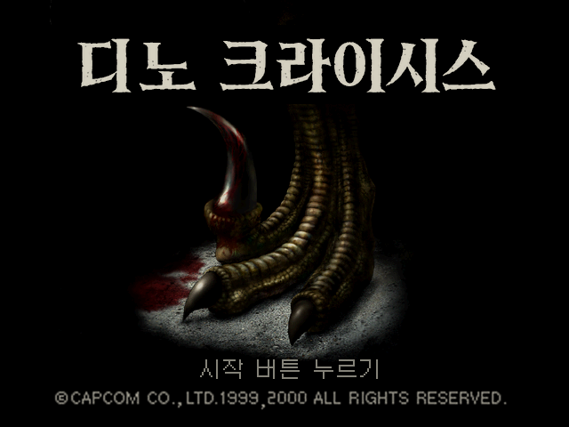
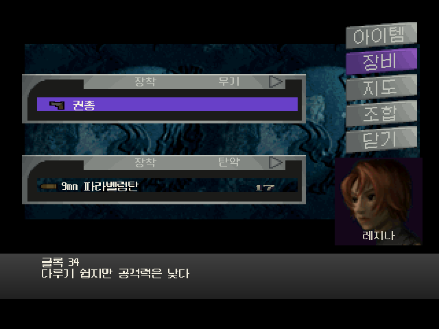
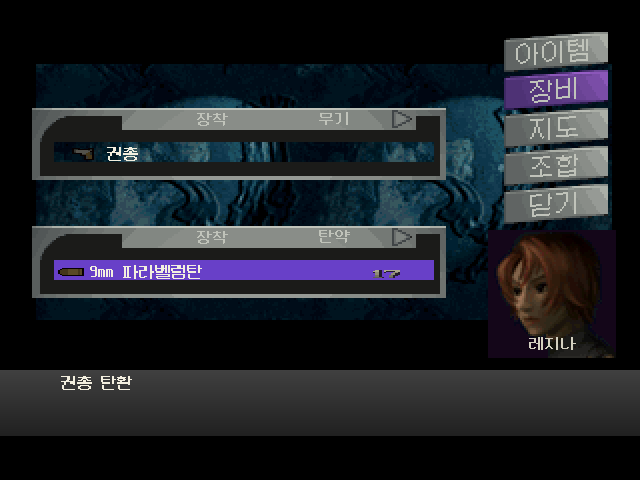
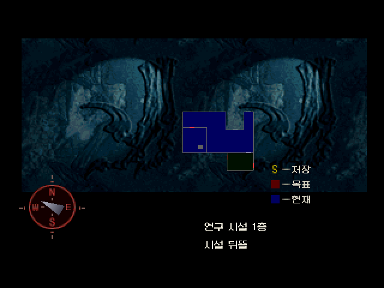
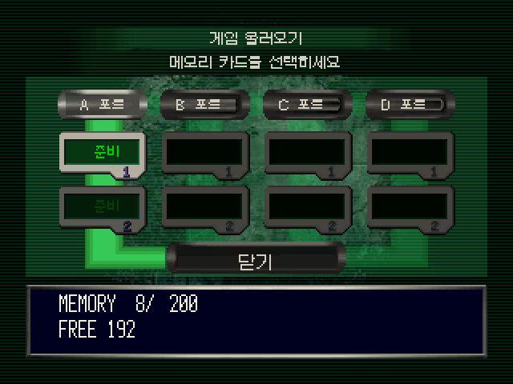
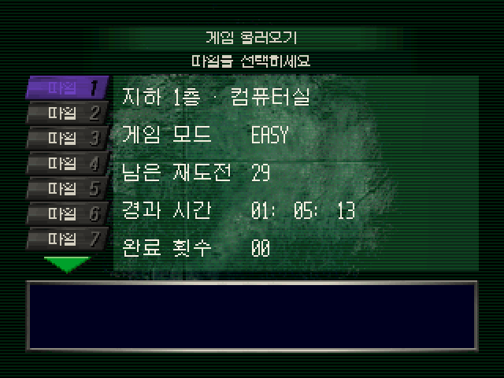
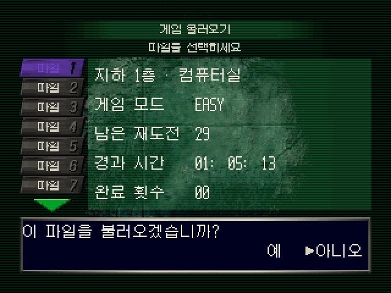
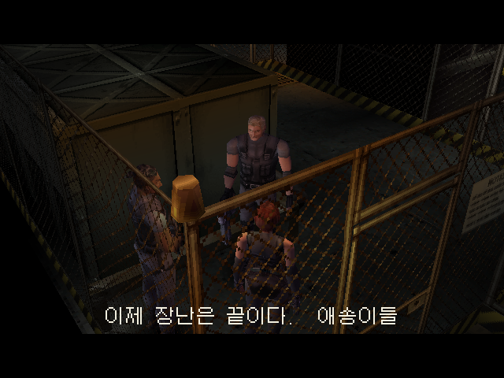
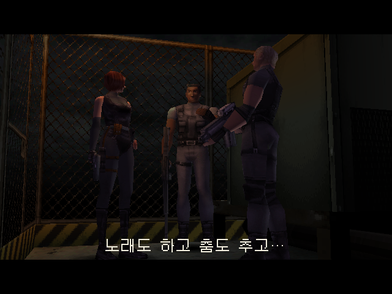
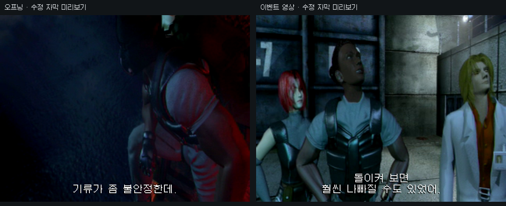

# 디노 크라이시스 한국어 패치 v0.81

Dreamcast 일본판 **Dino Crisis (Japan)** 한국어 패치입니다.

**한글화 · 기타 깎는 노인**

[**Windows용 v0.81 EXE 패처 받기**](https://github.com/OldManCraveGuitars-bit/DC-Dino-Crisis-Kr/releases/download/v0.81/DC-Dino-Crisis-Kr-v0.81-Patcher.exe) · [PowerShell 패치 ZIP](https://github.com/OldManCraveGuitars-bit/DC-Dino-Crisis-Kr/releases/download/v0.81/DC-Dino-Crisis-Kr-v0.81.zip) · [릴리스 안내](https://github.com/OldManCraveGuitars-bit/DC-Dino-Crisis-Kr/releases/tag/v0.81)

## Windows용 EXE 적용 방법

1. EXE 패처를 실행하고 아래 SHA-256과 일치하는 일본판 원본 CHD를 선택합니다.
2. 출력 CHD를 저장할 위치와 새 파일 이름을 지정합니다.
3. **한국어 패치 적용**을 누르고 완료 안내가 나올 때까지 기다립니다.

EXE에 패치 차분과 적용 도구가 들어 있습니다. 출력 드라이브에 3GB 이상의 여유 공간이 필요합니다. 적용 후 `Dino Crisis (Japan) Korean-v0.81.chd`를 실행하면 됩니다.

## PowerShell ZIP 적용 방법

1. 패치 ZIP을 풀고 SHA-256이 아래 표와 일치하는 일본판 CHD를 준비합니다.
2. Windows에서 PowerShell을 열고 ZIP을 푼 폴더로 이동합니다. 적용에는 chdman 0.264와 xdelta3 3.2.1을 사용했습니다. [MAME 0.264](https://github.com/mamedev/mame/releases/tag/mame0264) · [Xdelta 3.2.1](https://github.com/jmacd/xdelta/releases/tag/v3.2.1)
3. 아래 명령의 예시 경로를 각 파일의 위치에 맞춰 실행합니다.

~~~powershell
.\Apply-Patch.ps1 -SourceChd 'D:\ROMs\Dino Crisis (Japan).chd' -Chdman 'C:\Tools\chdman.exe' -Xdelta3 'C:\Tools\xdelta3.exe'
~~~

결과는 원본과 같은 폴더의 **Dino Crisis (Japan) Korean-v0.81.chd**입니다. 다른 위치에 저장하려면 -OutputChd 옵션에 새 파일 경로를 지정할 수 있습니다. 출력 드라이브에 4GB 이상의 여유 공간을 확보하세요. 패처는 원본·차분·결과물의 SHA-256을 대조하고 새 파일을 생성합니다. 패치 ZIP에는 적용 스크립트, 파일별 해시와 트랙 3의 차분이 들어 있습니다.

## v0.81 보이스 자막 검수

- 일본판 디스크의 영어 보이스 586개를 이벤트·무전·안내 자막과 대조해 476줄을 수정했습니다.
- 초소 대사의 노래와 춤, 도주 장면에서 티라노사우루스가 쫓아오는 방향, 전력 차단 장면의 퓨즈 고장 등 대사의 뜻을 반영했습니다.
- 구조 신호의 동서 방향이 영어 음성과 일본어 문구에서 다른 한 장면에는 일본판 진행 안내를 적용했습니다.

## 한글화 내용

- 타이틀, 설정, 인벤토리, 지도, 조합, 저장·불러오기 화면을 한글화했습니다.
- 장비·아이템 설명과 지도 장소명의 작은 글꼴을 정비했습니다. 입장 장소명의 띄어쓰기는 반각입니다.
- 가로 선택지 20곳과 저장·불러오기 확인창의 화살표 위치를 점검했습니다.
- 교신과 영상 자막은 가운데에 배치했습니다. 번역 재검수에서 음성 자막·보고와 메뉴 문구 61곳을 수정했습니다.
- 오프닝과 이벤트·엔딩 영상에 한국어 자막 31개를 적용했습니다.
- 초반 경계초소 장면의 대사를 ‘이제 장난은 끝이다. 애송이들’로 수정했습니다.

## 스크린샷

아래 두 장면은 원본 영상 프레임 위에 배포 빌드의 자막을 얹은 미리보기입니다.

## SHA-256

| 파일 | 크기(바이트) | SHA-256 |
| --- | ---: | --- |
| 일본판 원본 CHD | 537,130,056 | `e3966230c049659a925d3a0a5d7134e0e35de17bf897d5f591c7daff05cd65ed` |
| v0.81 적용 결과 CHD | 518,328,674 | `62c9d7c72e3c8d30beeda4a6e3ac6eac262d1167c90ee95970a9920810b32fcb` |
| Windows용 v0.81 EXE 패처 | 23,648,621 | `b0bf587a4f8c3de645f570a9c27b452be21a680aeeed02a48c31a40451c0a632` |
| ZIP 안의 트랙 3 차분 | 12,368,812 | `21d124d02793e07d1fe2c083ab9af0ee56c0d3a3bb1e2c48831fc9f8c4427e12` |
| v0.81 배포 ZIP | 10,805,017 | `2a2c5ff4a0eb6ed08cc9ca9e61b533420d7247e53391d114a837e47a370716fe` |

[파일별 해시](manifest.json) · [다운로드 해시](SHA256SUMS.txt)

## 검증 범위

- v0.81은 RetroArch 1.22.2의 Flycast 코어에서 한글 타이틀까지 부팅했고, Flycast에서 초소 장면의 자막과 가운데 정렬을 확인했습니다.
- v0.8에서 Flycast로 권총·탄환 이름, 장비 하단 설명, 지도 층·장소명과 범례를 확인했습니다.
- v0.8의 일본판 샘플 저장이 있는 검수용 VMU로 불러오기 포트, 파일 상세 정보, 확인창의 예·아니오와 화살표를 확인했습니다. [검수용 저장 파일 출처](https://bucanero.github.io/apollo-saves/DC/dinocrisis/)
- EXE와 ZIP으로 각각 일본판 원본을 패치한 결과, 완성 CHD의 크기와 SHA-256이 검수 빌드와 일치했습니다. EXE는 원본과 출력 경로에 한글과 공백을 넣어 검사했습니다. [검증 기록](docs/verification.json)

[패처 빌드 스크립트](tools/build-patcher.ps1) · [번들 도구와 라이선스](THIRD_PARTY_NOTICES.md)

비공식 팬 번역입니다. 게임과 스크린샷의 권리는 각 권리자에게 있습니다.
